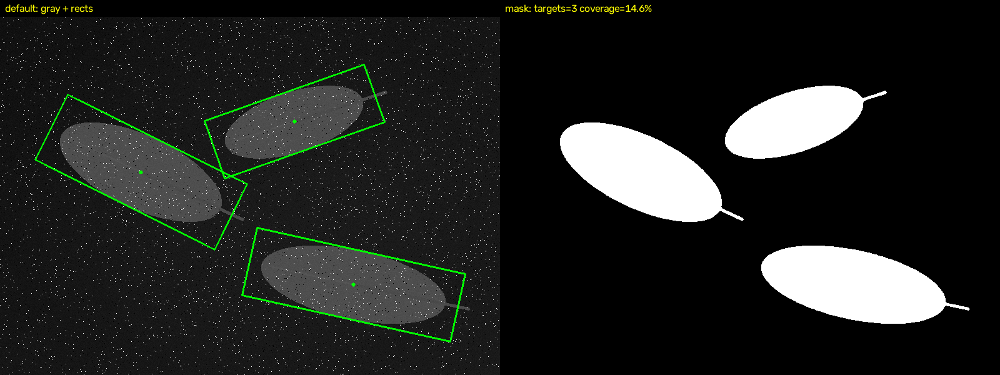
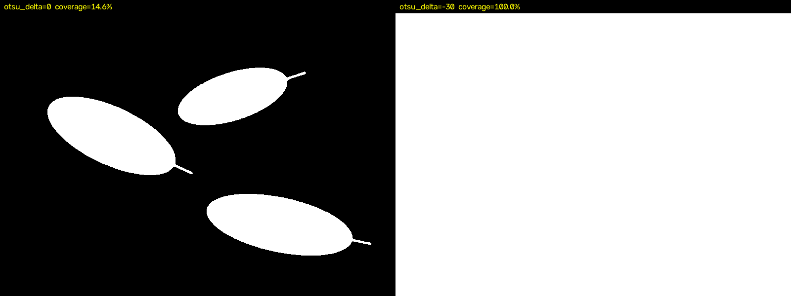
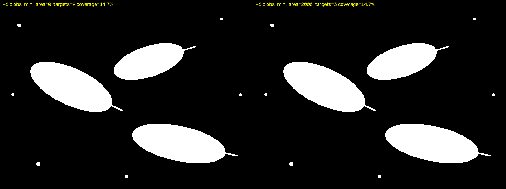

# D5 · OpenCV 参数实验记录

> **目的**：给每个参数留一条"改一个 → 量一个 → 得结论"的证据，而不是凭感觉说"这样看着更好"。
>
> **输入**：`data/samples/low_contrast_leaf.png`（背景灰度 26 / 叶片 78 / 2% 椒盐 / 3 片叶子）
> **真值**：`data/samples/low_contrast_leaf_truth.json`（面积 17506 / 25665 / 26062，中心与角度）
> **一键复现表格和图片**：`python tools/params_report.py`

---

## 1. 参数与指标（同一张图，逐项只改一个参数）

| 参数 | 取值 | 目标数 / 前景覆盖率 |
|---|---|---|
| `otsu_delta` | 0 | 3 / 14.62% |
| `otsu_delta` | 20 | 3 / 14.62% |
| `otsu_delta` | 30 | 3 / 14.62% |
| `otsu_delta` | -15 | 1 / 99.54% |
| `otsu_delta` | -30 | 1 / 100.00% |
| `min_area` | 2000 | 3 / 14.62% |
| `min_area` | 17500.0 | 3 / 14.62% |
| `min_area` | 18000.0 | 2 / 14.62% |
| `min_area` | 26000.0 | 1 / 14.62% |
| `min_area` | 27000.0 | 0 / 14.62% |
| `median_k` | 1 | 3 / 15.31% |
| `median_k` | 5 | 3 / 14.62% |
| `median_k` | 9 | 3 / 14.60% |
| `open_k` | 9 | 3 / 14.51% |
| `open_k` | 25 | 3 / 14.50% |
| `close_k` | 15 | 3 / 14.63% |
| `close_k` | 31 | 3 / 14.65% |
| `use_clahe` | True | 3 / 14.62% |

**怎么读这张表**：

- 真值覆盖率 = 三片叶子面积和 / 整图 = 68769 / 480000 = **14.33%**，所以 14.6% 附近就算对。
- 每次只改一个参数，另外 5 个保持默认，否则不知道是谁起的作用。
- 目标数是**硬指标**（必须是 3），覆盖率是**软指标**（判断 mask 有没有过大/过小）。

---

## 2. 截图证据

### 2.1 默认参数（median_k=5, otsu_delta=0, min_area=2000）



### 2.2 `otsu_delta = -30`：阈值跌破背景亮度



左边是正常 mask，右边全白。**阈值被压到背景亮度（26）以下之后，连背景都被判成前景**，所以目标数反而从 3 掉到 1。

### 2.3 加 6 个反光小点：面积过滤到底过滤了什么



两张图的 **mask 完全一样**，区别只在"轮廓 → 目标"这一步：左图 9 个目标（3 片叶子 + 6 个亮斑），右图 3 个。

> **关键认知**：面积过滤改的是**结果列表**，不是**像素**。所以它救不了"mask 本身错了"的情况。

---

## 3. 耗时（各 30 次平均，800×600）

| 阶段 | 耗时 (ms) | 占比 |
|---|---|---|
| 整条 `find_targets`（找轮廓 + 质心 + 最小外接矩形） | 1.17 | 100% |
| `cv2.medianBlur(k=5)` | 0.43 | 37% |
| `cv2.threshold(Otsu)` | 0.24 | 20% |
| `cv2.findContours` | 0.18 | 15% |
| `cv2.imread + cvtColor`（读图 + 转灰度） | **3.20** | **273%** |

最后一行是本表最值钱的发现：**读一张 PNG 比整条处理链还贵 2.7 倍**。所以将来做实时流水线时，瓶颈不在算法，在"每帧都从磁盘重新解码"。

---

## 4. 结论（这一段留给你写）

> 用自己的话，每条一句话 + 一个数字。不要抄上面的表，写"所以呢"。

1. **我最终选的参数**：`median_k=5`、`otsu_delta=40`、`open_k=0`、`close_k=0`、`min_area=17500.0`、`use_clahe=0`，理由是：中值k小清不干净噪点，大会把叶柄清掉。自动阈值取0，负数前景会覆盖，正数看起来没影响。开区间我取0，图片不用做开区间，值大会把叶柄给开掉。闭区间取0，图片不用闭区间。最小面积取17500.0，因为叶子最小的轮廓面积大于17500.0，开不开CLAHE都一样。
2. **最危险的参数是** otsu_delta，它的安全区是 0~40，越界后会发生 前景覆盖
3. **面积过滤在这里的唯一作用是** 筛选轮廓；如果没有它，可能会有其他轮廓。

写完把这三个数字填回 `src/classic/detect_targets.py` 里 `Params` 的默认值，再跑一次：

```bat
python tools\score_detect.py
```

必须仍然是 `PASS`。

---

## 5. 已知边界（诚实记录，别写成"可能"）

| 边界 | 实测结果 | 意味着什么 |
|---|---|---|
| `otsu_delta` 负方向 | −15 时前景已 99.5%，−30 时 100% | 这个参数只能往正方向调，不要往负调 |
| `close_k` 粘连 | 到 31 也没把三片叶子粘在一起 | 本图目标间距 >40px；换密集场景必须重测，不能照搬这个结论 |
| `open_k` 削目标 | 到 25 前景只从 14.62% 掉到 14.50% | 大目标不怕开运算；小目标（<50px）才会被削没 |
| `median_k` | 1 → 5 让前景从 15.31% 掉到 14.62% | 噪声贡献了 0.69% 的"假前景" |
| `use_clahe` | 开了和不开结果完全一样（3 / 14.62%） | 这张图的对比度本来就够；CLAHE 不是万能的 |
| 读图耗时 | 3.20 ms vs 处理 1.17 ms | 优化顺序应该是"别重复读图" > "改算法" |
